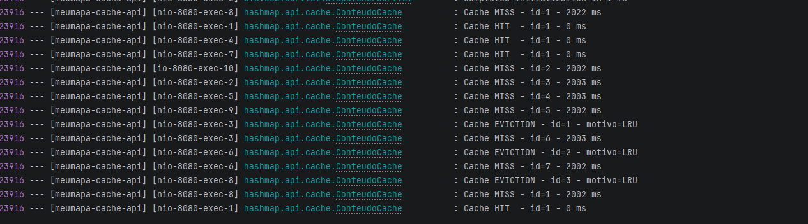
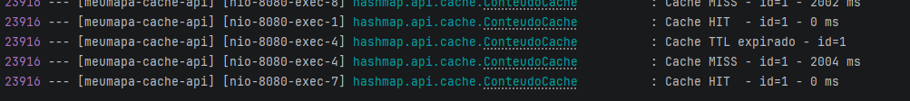
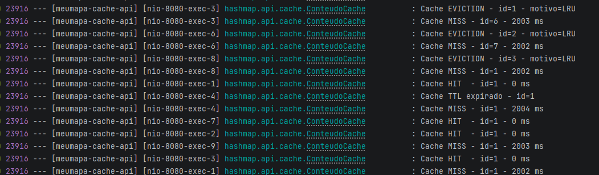
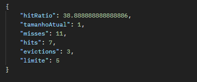

# Bill hebert

Git: https://github.com/BillHebertPDC/Cache-hashmap

## O que é cache e qual problema ele resolve?

Cache é uma camada de armazenamento temporário e rápido que mantém cópias de dados usados com frequência. Quando uma cópia está disponível e válida, o sistema pode usá-la em vez de buscar ou calcular o dado novamente na fonte original.

**O que melhora:** tempo de resposta, uso da rede e carga sobre servidores e bancos de dados. O cache costuma usar memória (RAM), mas também pode usar armazenamento local, como SSD ou disco.

### Dois exemplos do dia a dia

1. **Navegador:** guarda imagens, CSS e JavaScript no dispositivo do usuário, em memória e/ou no disco. Ao revisitar uma página, pode reutilizar esses arquivos sem baixá-los todos de novo.
2. **CDN:** mantém cópias de imagens, vídeos e outros arquivos em servidores próximos dos usuários. Isso diminui a distância da transferência e reduz as solicitações que chegam ao servidor de origem.

**Outras camadas:** a aplicação pode guardar respostas de uma API na RAM ou em Redis; o banco de dados pode manter páginas de dados acessadas com frequência na memória.

## Cache hit, cache miss e hit ratio

- **Cache hit (acerto):** o dado procurado está no cache e pode ser usado, evitando em geral uma consulta à fonte original.
- **Cache miss (falha):** o dado não está no cache, foi removido ou expirou. O sistema busca o dado na fonte original e pode guardar uma cópia para as próximas solicitações.
- **Hit ratio (taxa de acerto):** proporção das buscas no cache que foram acertos. Uma taxa maior costuma indicar que o cache está atendendo bem às solicitações, mas não garante, sozinha, que os dados estejam atualizados.

> **Fórmula:** `Hit ratio (%) = hits ÷ (hits + misses) × 100`  
> **Exemplo:** 90 hits e 10 misses resultam em um hit ratio de **90%**.

## TTL e dados stale

**TTL (Time To Live)** é o tempo de validade atribuído a um dado no cache, normalmente medido em segundos. Quando o TTL termina, o cache pode remover o dado ou exigir que ele seja buscado/revalidado novamente.

Um dado fica **stale** (velho ou desatualizado) quando a fonte original muda, mas o cache ainda guarda uma cópia anterior. Sem invalidação ou atualização imediata, essa cópia pode continuar sendo usada até o TTL vencer. Algumas estratégias também permitem servir uma cópia stale enquanto atualizam o cache em segundo plano.

- **TTL longo:** pode aumentar os acertos e reduzir a carga na fonte, mas aumenta o tempo em que uma alteração pode não aparecer. Faz sentido para conteúdo que muda pouco, como imagens e arquivos estáticos versionados.
- **TTL curto:** limita o tempo de desatualização, mas causa mais misses e consultas à fonte. Pode ser necessário para informações que mudam com frequência, como estoque. Para dados críticos, o TTL sozinho pode não ser suficiente: pode ser preciso invalidar o cache quando o dado muda.

## Políticas de remoção (eviction): FIFO, LRU e LFU

Essas políticas decidem **qual item remover quando o cache precisa liberar espaço**. São diferentes do TTL, que determina por quanto tempo um item é considerado válido.

| Política | Como funciona | Quando faz mais sentido |
| --- | --- | --- |
| 📥 **FIFO** (First In, First Out) | Remove primeiro o item que está há mais tempo no cache, sem considerar quantas vezes foi usado recentemente. | Quando se quer uma regra simples e a idade do item é um critério razoável para removê-lo. |
| 🕒 **LRU** (Least Recently Used) | Remove o item que ficou há mais tempo sem ser acessado. | Quando dados acessados recentemente têm maior chance de serem usados de novo, como em muitos padrões de navegação. |
| 🔢 **LFU** (Least Frequently Used) | Remove o item com menos acessos em um período ou conforme um contador de frequência. | Quando há um conjunto estável de itens muito populares que deve permanecer no cache. Se a popularidade muda, acessos antigos podem influenciar demais. |

Não existe uma política ideal para todos os casos: a escolha depende do padrão de acesso, do custo de buscar os dados e da implementação do cache.

## 🔄 Invalidação de cache: por que é difícil?

**Invalidar o cache** é remover ou atualizar uma cópia armazenada quando o dado original muda, para evitar que o sistema continue usando uma versão antiga. Isso pode ser feito apagando a chave correspondente, substituindo seu valor ou usando versões nas chaves.

É difícil porque o mesmo dado pode estar copiado em vários lugares — em diferentes servidores, navegadores ou CDNs — e todas essas cópias precisam ser atualizadas de forma coordenada. Também podem ocorrer concorrências:

1. Uma solicitação lê um valor antigo da fonte.
2. Outra operação atualiza a fonte e invalida a chave do cache.
3. A primeira solicitação grava o valor antigo no cache depois da invalidação.

⚠️ **Resultado:** a cópia antiga reaparece. Por isso, é preciso equilibrar consistência, desempenho e complexidade. O TTL reduz por quanto tempo uma cópia pode permanecer, mas não garante que todas as cópias sejam atualizadas imediatamente.

## 🏠 Cache local vs. cache distribuído

| Tipo | Características | Limitações |
| --- | --- | --- |
| 🏠 **Local** | Fica na memória do processo da aplicação. É rápido e simples de acessar, sem uma chamada de rede adicional. | Cada instância da aplicação tem sua própria cópia; as cópias podem divergir. Os dados normalmente se perdem quando o processo reinicia, e o espaço é limitado à memória dessa instância. |
| ☁️ **Distribuído** (ex.: Redis ou Memcached) | Fica em um serviço separado, acessível por várias instâncias da aplicação, que podem compartilhar o mesmo cache. | Exige comunicação pela rede e operação de um serviço adicional; é preciso considerar latência, disponibilidade e configuração. |

### Quando o cache local deixa de ser suficiente?

- Há várias instâncias da aplicação que precisam compartilhar os mesmos dados.
- As cópias locais começam a divergir ou a duplicação ocupa memória demais.
- O conjunto de dados excede a capacidade local.

Um cache distribuído pode ajudar nesses casos. Ainda assim, os dois tipos podem ser usados juntos: o local para acessos muito frequentes e o distribuído como camada compartilhada.


## Executar


```bash
mvn spring-boot:run
```

A API fica em `http://localhost:8080`. O banco H2 é em memória; os conteúdos são recriados quando a aplicação reinicia.

## Configuração

Em `src/main/resources/application.properties`:

```properties
app.cache.max-itens=5
app.cache.ttl-segundos=60
```

O atraso artificial de 2 segundos ocorre somente em um MISS. 
Para testar o TTL mais rapidamente, altere temporariamente `app.cache.ttl-segundos` para `10` e reinicie a aplicação.

## Endpoints

| Método | Rota | Resultado |
| --- | --- | --- |
| `POST` | `/conteudos` | Cadastra um conteúdo. |
| `GET` | `/conteudos/{id}` | Busca no cache ou no banco; responde com `X-Cache: HIT` ou `X-Cache: MISS`. |
| `PUT` | `/conteudos/{id}` | Atualiza o conteúdo e invalida sua entrada no cache. |
| `DELETE` | `/conteudos/{id}` | Exclui o conteúdo e invalida sua entrada no cache. |
| `GET` | `/cache/estatisticas` | Retorna tamanho, limite, hits, misses, evictions e hit ratio (%). |
| `DELETE` | `/cache` | Remove os itens do cache; mantém os contadores de estatísticas. |

Exemplo de corpo para `POST` e `PUT`:

```json
{
  "titulo": "Conteúdo 1",
  "corpo": "Texto de exemplo",
  "autor": "Ana"
}
```


### Exemplo de validação local

Com sete conteúdos cadastrados e a configuração padrão, a primeira busca levou cerca de 2 segundos e a segunda foi rápida. A sequência LRU removeu o ID 2; depois do PUT, o GET do ID 1 voltou como MISS. As estatísticas observadas foram:

```text
GET id=1 X-Cache=MISS 2069 ms
GET id=1 X-Cache=HIT 20 ms
GET id=6 X-Cache=MISS 2026 ms
GET id=2 X-Cache=MISS 2026 ms
GET id=1 X-Cache=MISS 2027 ms  (depois do PUT)
{"tamanhoAtual":5,"limite":5,"hits":2,"misses":8,"evictions":2,"hitRatio":20.0}
```

Para validar a expiração rapidamente, também foi feito um teste isolado com TTL de 1 segundo: o segundo GET, após aguardar 2 segundos, retornou MISS.
Os logs da aplicação indicam o resultado e o tempo de cada busca, por exemplo:

```text
INFO  ConteudoCache : Cache MISS - id=1 - 2037 ms
INFO  ConteudoCache : Cache HIT  - id=1 - 0 ms
INFO  ConteudoCache : Cache EVICTION - id=2 - motivo=LRU
INFO  ConteudoCache : Cache TTL expirado - id=1
```
## Evidencias





## Passos da referencia
1. Inicie a aplicação e execute os sete requests de cadastro.
2. Faça `GET /conteudos/1` duas vezes. A primeira deve retornar `X-Cache: MISS` e levar aproximadamente 2 segundos; a segunda, `X-Cache: HIT` e ser rápida.
3. Busque os IDs `2`, `3`, `4` e `5`, depois busque `1` novamente para torná-lo o mais recentemente usado. Busque `6`: o cache atinge o limite de cinco e o log mostra a remoção LRU do ID `2`. Busque `2` para confirmar um novo MISS.
4. **TTL:** com TTL de 10 segundos, busque um ID para aquecer o cache, aguarde mais de 10 segundos e busque-o novamente. Deve ocorrer um MISS. Com a configuração padrão, aguarde mais de 60 segundos.
5. Faça `GET /conteudos/1`, depois `PUT /conteudos/1` com outro corpo e, por fim, outro `GET /conteudos/1`. O último deve retornar `X-Cache: MISS`, pois o PUT invalidou a entrada.


## Referencias

https://developer.mozilla.org/pt-BR/docs/Web/HTTP/Guides/Caching
https://web.dev/articles/http-cache
https://www.cloudflare.com/learning/cdn/what-is-caching/
https://developers.cloudflare.com/cache/
https://redis.io/docs/latest/develop/use-cases/cache-aside/
https://redis.io/solutions/caching/
https://www.hellointerview.com/learn/system-design/core-concepts/caching


